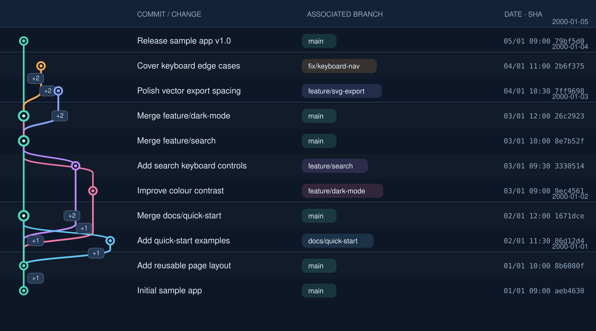

# diGITrail

**Interactive Git history visualizer for AI agents and the command line.**

Turn a Git repository into a single, portable HTML report. Explore branch forks, merges and commit ancestry in a GitKraken-style graph, with search, branch highlighting and SVG export. Runs locally with Python's standard library; the report works offline in your browser.

[Download ZIP](https://github.com/0biguan/diGITrail/archive/refs/heads/main.zip) · [Try the demo](#try-the-demo) · [Zero-install AI](#zero-install-ai-with-chatgpt-work) · [Quick start](#quick-start) · [Use as an agent skill](#use-as-an-agent-skill)



*Actual graph output from the bundled renderer. This entirely fictional sample contains 23 commits, 6 branches and 3 merges. Structure view compresses it into 11 visible nodes. All names, identifiers, messages, dates and parent relationships were created for this example.*

## Why diGITrail?

- **Real Git ancestry:** connections follow ordered commit parents, preserving actual forks and merges.
- **Readable branch history:** the primary branch stays in the first lane and every visible node has a full branch label.
- **Two levels of detail:** Structure view compresses linear chains; All commits shows every commit.
- **Interactive exploration:** reverse chronology, search commits, highlight a branch, zoom and inspect commit details.
- **Portable output:** share one self-contained HTML file or export the graph as SVG.
- **Read-only and local:** the generator reads Git without changing your repository or starting CI. Reports need no server, CDN or third-party Python packages.
- **Three usage modes:** zero-install AI in a capable cloud assistant, installed agent skill, or local CLI. All use the original renderer; multiple repositories can share one report.

## Try the demo

1. [Download the repository ZIP](https://github.com/0biguan/diGITrail/archive/refs/heads/main.zip) and extract it.
2. Open **`examples/demo.html`** in a modern browser. The prebuilt demo requires no Python installation.
3. Switch between **Structure view** and **All commits**, reverse the order, search for `keyboard`, click a commit or select **Export SVG**.

The demo includes the complete interface and its controls. Its [fictional source data](examples/demo.json) and [regeneration instructions](examples/README.md) are included. The README image shows the graph area; a [vector version](docs/images/digitrail-preview.svg) is also available.

## Zero-install AI with ChatGPT Work

**No local setup, no skill installation.** In a supported ChatGPT **Work** session, you can give the assistant the diGITrail source URL, the Git repository to analyse, and a time range. Work uses its own cloud computer to obtain the original code and verified Git history, runs the bundled Python generator, and returns a **standalone interactive HTML file**. Nothing needs to be installed on your own machine.

**Requirements and availability**

- Use **ChatGPT Work** with access to a **network-enabled cloud computer/terminal**. Work availability and permissions depend on your ChatGPT account and workspace. Simply opening a normal chat or pasting an `SKILL.md` URL does not install or execute a skill automatically.
- Work must be allowed to read the selected GitHub repositories, download the project files, and run **Git** and **Python 3.9+** in its cloud environment. The generator needs only the Python standard library. A modern browser is needed to open the resulting HTML.
- The target must be accessible to the assistant. Public GitHub repositories are the simplest case; private ones need separately authorised access. Never place credentials or tokens inside a prompt.
- The assistant must retrieve **complete Git ancestry and branch refs**, not a shallow checkout, and execute diGITrail's **original** `scripts/generate_git_graph.py` and `assets/template.html`. It must not reconstruct the chart with Mermaid or another renderer.
- Git cloning into a **temporary cloud directory** is permitted for this workflow; it reads from GitHub but creates temporary files in Work. Do **not** push, alter remote refs, or trigger workflows. The output HTML is created in temporary cloud storage and can be downloaded from the chat.

### Try it in a new Work conversation

1. Open ChatGPT, start a **new Work conversation** (not a normal Chat session), and ensure cloud-computer/network access is available.
2. Copy the prompt below. It deliberately points to the **experimental branch** so that the stable `main` version stays untouched.
3. Work should return an HTML file. Open it in a browser and check **Structure view**, **All commits**, chronological reversal, branch search/highlighting, and **Export SVG**.

> Use the **original diGITrail** from the experimental branch:
>
> https://github.com/0biguan/diGITrail/tree/feature/ai-distribution
>
> Generate a standalone interactive HTML Git history report for:
>
> https://github.com/0biguan/diGITrail-sample
>
> Analyse **branch activity from 1 October 2026 (00:00 UTC) through the time of this request**. Do not use a rolling seven-day period. Keep all verified earlier ancestors needed to show genuine branch origins. Calculate the correct `--as-of` and `--days` parameters for the date-based activity cutoff; diGITrail's CLI does not currently have a `--since` option. Include remote branch refs available in the full checkout.
>
> First read `SKILL.md` from that exact diGITrail branch. If your Work cloud computer has network access, retrieve the reviewed source and a **full-history** clone of the sample into isolated temporary cloud directories. Run the **original** `scripts/generate_git_graph.py` with its original HTML template and deliver the actual HTML file for download.
>
> Do not install anything on my computer. Do not change either GitHub repository, push commits or tags, or run GitHub Actions. Do not use Mermaid or recreate diGITrail. If a required capability is missing, explain the specific limitation instead of inventing data or substituting another renderer.

**What “from 1 October 2026” means:** the starting date selects branches with relevant **commit activity**; the renderer preserves their earlier reachable ancestors so forks and merges retain their genuine origins. Git does not reliably store branch creation dates. The report may therefore display older commits as ancestry context. For a graph that includes inactive branches too, explicitly ask for **all branches** (`--all-branches`).

**Tested scope (25 October 2026):** a user successfully generated the original HTML with ChatGPT Work. The resulting file was checked against the shipped HTML template and GitHub branch heads, and its interactive controls passed browser tests. See [AI certification results](docs/AI_CERTIFICATION.md) and [AI usage details](docs/AI_USAGE.md). This **does not guarantee** the same capabilities in every Work account or in ordinary ChatGPT; a standard-chat test failed because its Python environment could not access the required GitHub resources.

**Other AI assistants:** diGITrail's instructions and Python generator may also work in assistants such as **Claude**, provided they can retrieve the files and full Git history and execute the code. **No Claude or other-assistant test has been performed here.** Their compatibility and setup requirements are unknown, not ruled out.

## Quick start

**Requirements:** Python 3.9+ and Git, on Windows, Linux or macOS. The generator uses only the Python standard library. A modern browser opens the resulting report.

Download and extract the ZIP, or clone the project:

```bash
git clone https://github.com/0biguan/diGITrail.git
cd diGITrail
```

Generate a report for a local repository:

```bash
python3 scripts/generate_git_graph.py --repo /path/to/repository --days 7 --output git-history.html
```

Windows PowerShell:

```powershell
py scripts/generate_git_graph.py --repo 'C:\path\to\repository' --days 7 --output git-history.html
```

Open `git-history.html` in your browser. For a first run with the included example data:

```bash
python3 scripts/generate_git_graph.py --input-json examples/demo.json --output git-history.html
```

Useful options:

| Goal | Option |
| --- | --- |
| Include inactive branches | `--all-branches` |
| Select a different primary branch | `--base master` |
| Include remote refs already stored locally | `--remotes` |
| Save validated source data alongside the report | `--also-json git-history.json` |
| Use a reproducible reference date | `--as-of 2000-01-08` |
| Combine repositories | Repeat `--repo` for each repository |

Run `python3 scripts/generate_git_graph.py --help` for all options. Use `py` instead of `python3` with the Windows Python launcher.

## Use as an agent skill

The internal skill name is **`digitrail`**. Keep [`SKILL.md`](SKILL.md), `scripts/`, `assets/` and `references/` together in the skill folder used by your assistant, following that environment's installation instructions. Downloading the repository alone does not install a skill in an account.

Example requests:

> Use diGITrail to visualise the branches and merges in this repository with activity from 1 October 2026 through today, preserving the earlier ancestry needed to explain forks.

> Generate an offline Git history report for these two local repositories, with main in the first lane.

The assistant needs access to Python and a local Git checkout, or complete, verified commit data from a connector. The [connector JSON format](references/data-format.md) documents the alternative input path.

## How history is interpreted

The default seven-day window selects branch heads with recent **commit activity**. Complete reachable ancestry is retained to show where those branches forked, even when it extends beyond the window. Git does not normally record reliable branch creation dates.

- Branch labels on shared commits are inferred visual associations. A commit may belong to the ancestry of several branches.
- Graph edges use commit parent relationships. Pull request targets alone do not establish ancestry.
- The default exploration limit is 30,000 commits. Generation stops if that limit is exceeded; adjust `--max-history` when appropriate.
- Missing parents in a shallow clone are reported as incomplete history. Repositories can also legitimately contain multiple unrelated roots.
- Reports embed commit messages, branch names and repository metadata. Review generated reports before sharing them publicly.

## Project structure

| Path | Purpose |
| --- | --- |
| [`SKILL.md`](SKILL.md) | Agent instructions and accuracy requirements |
| [`scripts/generate_git_graph.py`](scripts/generate_git_graph.py) | Standalone Python CLI |
| [`assets/template.html`](assets/template.html) | Self-contained report interface |
| [`examples/`](examples/) | Fictional demo, editable JSON and reproduction guide |
| [`docs/images/`](docs/images/) | Public preview image and vector export |
| [`references/data-format.md`](references/data-format.md) | Connector input schema |
| [`tests/`](tests/) | Local Git ancestry and optional browser regression tests |
| [`.github/ISSUE_TEMPLATE/`](.github/ISSUE_TEMPLATE/) | Bug reports and feature suggestions |

## Contributing

Bug reports, documentation improvements and reproducible examples are welcome. See [CONTRIBUTING.md](CONTRIBUTING.md) for the development workflow and privacy guidelines for examples.

```bash
python3 -m unittest discover -s tests -v
```

The optional browser test uses a locally installed Chromium browser through Playwright. The generator does not require either package. No hosted CI is needed to run the tests.

## License and commercial permissions

**diGITrail is source-available under the PolyForm Noncommercial License 1.0.0.**
Personal and other uses permitted by the license are free. Commercial use is **not granted** by this license and requires separate written permission from the copyright holder. See [`LICENSE`](LICENSE) for the full binding terms. To enquire about a commercial license, contact the project owner through GitHub.

This is a noncommercial software license, **not an OSI-approved open-source license**.

Required Notice: Copyright 2026 0biguan (https://github.com/0biguan/diGITrail)
